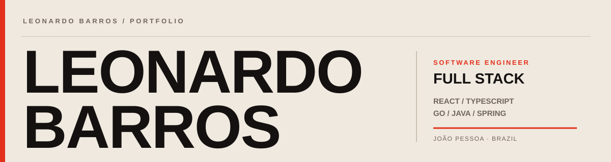
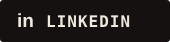

<a href="https://leonardobarros.vercel.app">
  <picture>
    <source media="(prefers-color-scheme: dark)" srcset="assets/banner-dark.svg">
    
  </picture>
</a>

  
  
  

I build the whole path of a feature: the interface, the API behind it, the database and the pipeline that ships it. React + TypeScript on the front end, Go and Java (Spring Boot) on the back end. Based in João Pessoa, Brazil (UTC−3) · Portuguese native, English C2.

  <code>TypeScript</code> <code>React</code> <code>Vite</code> <code>Tailwind</code> <code>Go</code> <code>Java</code> <code>Spring Boot</code> 
  <code>Python</code> <code>PostgreSQL</code> <code>Redis</code> <code>Kafka</code> <code>Docker</code> <code>GitHub Actions</code>

## Selected work

<table>
  <tr>
    <td width="50%" valign="top">
      
      <h3><a href="https://github.com/leonardobarrosx/motor-transferencias">Motor de Transferências</a></h3>
      Study banking core with Pix: ACID, idempotent transfers on a double-entry ledger, and Pix to other banks as a saga over Kafka and Apache Camel. 105 tests against real PostgreSQL and Kafka.
        <code>Java 21</code> <code>Spring Boot</code> <code>Kafka</code> <code>Apache Camel</code> <code>React</code>
    </td>
    <td width="50%" valign="top">
      
      <h3><a href="https://github.com/leonardobarrosx/argus-project">Argus</a></h3>
      Multi-tenant SaaS for optical stores. PostgreSQL Row Level Security isolates each tenant even if a query forgets the filter; integration tests run against a real database.
        <code>Go</code> <code>React</code> <code>TypeScript</code> <code>PostgreSQL</code>
    </td>
  </tr>
  <tr>
    <td width="50%" valign="top">
      
      <h3><a href="https://meuchamado.vercel.app">Meu Chamado</a> · private repo</h3>
      Multi-tenant helpdesk for an IT team serving 56 municipal health units, validated with the client before homologation.
        <code>React</code> <code>TypeScript</code> <code>Go</code> <code>PostgreSQL</code>
    </td>
    <td width="50%" valign="top">
      
      <h3><a href="https://leonardobarros.vercel.app/#work/vesta">Vesta</a> · private repo</h3>
      Restaurant SaaS with five interfaces: management, waiter PWA, kitchen KDS, landing page and superadmin. Go/Gin and PostgreSQL power tenant-isolated operations, with real-time updates over SSE.
        <code>Go</code> <code>React</code> <code>TypeScript</code> <code>PostgreSQL</code>
    </td>
  </tr>
  <tr>
    <td width="50%" valign="top">
      
      <h3><a href="https://github.com/leonardobarrosx/ninho">Ninho</a></h3>
      Family finance app published for Android and web: a Flutter client over a Go API on Supabase.
        <code>Flutter</code> <code>Go</code> <code>Supabase</code>
    </td>
    <td width="50%" valign="top">
      
      <h3><a href="https://github.com/leonardobarrosx/soluna">Soluna</a></h3>
      2D online RPG engine with an authoritative UDP server at 20 Hz and in-game editors validated by the server.
        <code>C#</code> <code>.NET</code> <code>MonoGame</code>
    </td>
  </tr>
</table>

This profile's portfolio is <a href="https://github.com/leonardobarrosx/leonardobarros-portfolio">open source</a> too: Vite + React + TypeScript, seven languages, AA contrast and reduced-motion support.

## Now

- **Senior Planning & Data Intelligence Analyst at AeC.** I audit the automations behind the planning reports: queries, API responses and calculation rules.
- **Freelance full-stack development** since 2016.
- **Looking for** a full-time software engineering role (full stack, front end or back end), remote or hybrid.
